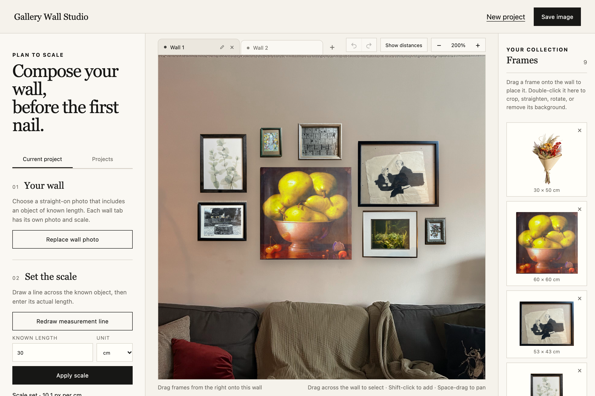

# Gallery Wall Studio

A browser-based tool for planning a gallery wall to scale. Calibrate a photograph of a room using an object of known length, add framed artwork with its real dimensions, and arrange the frames directly on the wall image.



## Features

- Plan several walls in one project, each in its own browser-style tab with its own photo and calibration.
- Calibrate each wall photo in centimetres or inches using a visible object of known length.
- Import PNG, WebP, JPEG, HEIC, and HEIF frame photos with real outside dimensions.
- Correct frame perspective with four independently movable scanner-style corners, fine straightening, and 90° rotation.
- Reopen and expand non-destructive crops or reset a frame to its original upload.
- Share one frame collection across every wall in a project; frames are sized to each wall's own scale.
- Arrange accurately scaled frames with dragging, keyboard nudging, zooming, and canvas panning.
- Show readable distances between neighboring frames.
- Automatically save, rename, reopen, and delete local projects.
- Export the finished composition as a PNG.

## Requirements

- A recent version of Node.js
- A modern desktop browser
- A straight-on photograph of the wall containing an object with a known length
- PNG, WebP, JPEG, HEIC, or HEIF images of the framed artwork

## Run locally

From the repository root, install dependencies and start the local server:

```bash
npm install
npm run dev
```

Open <http://localhost:4173>.

To use another port:

```bash
PORT=3000 npm run dev
```

## How to use it

1. **Upload a wall photo.** Include a ruler, measuring tape, or another object whose real length you know.
2. **Calibrate the scale.** Draw a line over the known object, enter its length, select centimetres or inches, and apply the scale. Reapplying the scale updates every placed frame on that wall together.
3. **Add framed artwork.** Frames belong to the project, so every wall can use them. Upload PNG, WebP, JPEG, HEIC, or HEIF images and enter each frame's outside width and height using the selected unit.
4. **Prepare a frame.** Double-click a frame in the right rail to move its four crop corners independently, straighten the selected area into a rectangle, fine-tune its angle, or rotate it 90°. Cropping is non-destructive, so reopening the editor lets you expand the crop again or reset to the original upload. The rail previews preserve the frames' relative physical sizes.
5. **Arrange the wall.** Drag frames from the right rail onto the wall. Drag a placed frame to move it, use the arrow keys for precise positioning, or press Delete to remove it. Use **Show distances** to label gaps between directly neighboring frames. Zoom from 50% to 500%; at higher zoom, drag the wall to pan while measurement text stays the same on-screen size.
6. **Add more walls.** Select **+** beside the wall tabs to add another wall to the same project, then upload its photo and calibrate it separately. A dot on each tab fills in once that wall's scale is set. Double-click a tab to rename it, or use its × to delete that wall. Your frames stay in the project.
7. **Start another project.** Select **New project**. The current project is saved before a blank workspace opens.
8. **Export the layout.** Select **Save image** to download the current wall as a PNG.

## Saved projects

Projects are saved automatically to `.gallery-wall-data/projects/`, one JSON file per project (holding its frames and all of its walls), in the local repository. Older `projects.json` stores are split into this folder automatically on the next launch. The **Projects** tab lets you reopen projects or use the thumbnail’s ••• menu to rename and delete them. Frames can be removed from the right rail with their × button; this also removes their placed copies.

Projects saved by older single-wall versions open as a project with one wall. Deleted projects are moved to `.gallery-wall-data/backups/` and their ids are recorded in `.gallery-wall-data/deleted.json`, so a stale copy in another browser profile is removed rather than restored. A delete made while the server is unreachable is retried on the next launch.

The data directory is intentionally gitignored because it contains the uploaded photos. Saved projects are available from any browser profile or port running this repository. On every launch, the app reconciles that profile's browser backup with the shared repo-backed store, so older browser-only projects are copied over automatically.

## Privacy

Photos and layouts remain on your computer. The local development server writes projects only to `.gallery-wall-data/`; it does not upload images or project data anywhere.

## Project structure

```text
dist/
  index.html    Application markup
  styles.css    Layout and visual styles
  app.js        Calibration, editing, persistence, and export logic
scripts/
  dev.mjs       Local development server and project storage API
docs/
  gallery-wall-studio.png  README screenshot
package.json    npm scripts
.gallery-wall-data/  Local saved projects, deleted-project backups (created automatically, gitignored)
```
